<div align="center">

# 🎮 GameStation Core

**Enterprise-Grade Distributed Gaming Marketplace, Commerce Engine & Telemetry Platform**

*Engineered with React 19, TypeScript, Node.js, PostgreSQL 18, Docker, and W3C OpenTelemetry.*

[](https://www.typescriptlang.org/)
[](https://react.dev/)
[](https://nodejs.org/)
[](https://www.postgresql.org/)
[](https://www.docker.com/)
[](https://www.prisma.io/)
[](https://tailwindcss.com/)
[](https://socket.io/)
[](https://stripe.com/)

<p align="center">
  <a href="#architecture">Architecture</a> •
  <a href="#deep-dives">Engineering Deep Dives</a> •
  <a href="#tech-stack">Tech Stack</a> •
  <a href="#quickstart">Quickstart</a> •
  <a href="#benchmarks">Benchmarks</a>
</p>

</div>

---

## 🏛️ Executive Overview

**GameStation** is a distributed gaming commerce and real-time telemetry ecosystem designed to handle real-world backend challenges: **eventual consistency across distributed transactions**, **sub-millisecond search indexing**, **in-house observability profiling**, and **high-concurrency real-time state synchronization**.

<div align="center">
  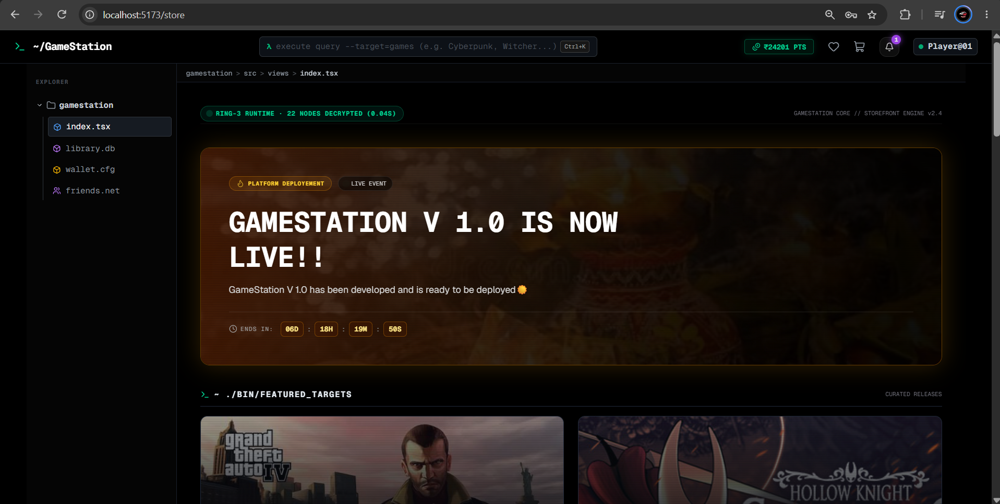
  <p><em>GameStation Core Storefront: Ring-3 runtime featuring live catalog discovery, promotional events, and active player telemetry.</em></p>
</div>

---

<a id="architecture"></a>
## 🏗️ System Architecture

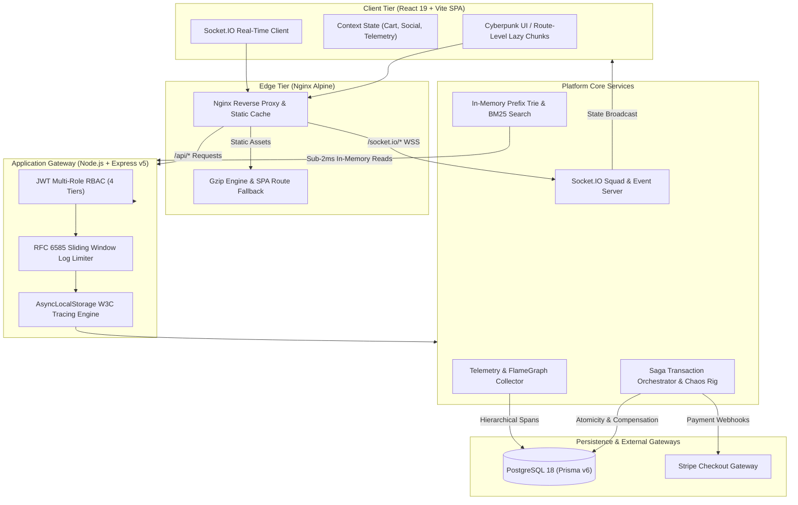

---

<a id="deep-dives"></a>
## ⚡ Engineering Deep Dives

### 1. Distributed Saga Transaction Orchestrator & Chaos Fault Rig

In digital game distribution, checkouts span non-transactional boundaries: external payment gateways (Stripe), internal wallet balances, DRM license issuance, and developer royalty settlements. Using traditional Two-Phase Commit (2PC) creates blocking dependencies and database connection starvation across network boundaries.

GameStation implements a custom **Saga Orchestrator** to guarantee eventual consistency:

```
[Forward Execution]
Validate Inventory ──> Deduct Wallet / Stripe ──> Issue DRM License ──> Disburse Royalty
                                                        │ (Failure Injected)
[Backward Compensation Loop]                            ▼
Restore Wallet Funds <── Revoke DRM License <── Halt Settlement <── Trigger Rollback
```

- **Forward Pipeline**: Coordinates validation, payment capture, license key generation, and 70/30 platform revenue splits.
- **Backward Compensation Loop**: If any step fails or hardware faults occur, the orchestrator triggers an automatic reverse compensation loop that revokes provisional licenses, refunds wallet points, and marks the transaction state as `COMPENSATED (ROLLED BACK)`.
- **Chaos Fault Simulator**: Built directly into the platform operations deck to allow engineers to inject deliberate failures into individual steps and verify backward compensation rollbacks in real time.

<div align="center">
  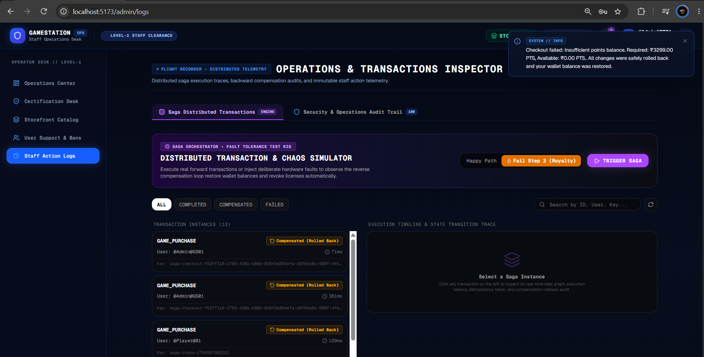
  <p><em>Operations & Transactions Inspector: Live audit trail displaying compensated transactions, execution latency, and the Chaos Simulator fault injection rig.</em></p>
</div>

---

### 2. Stripe Checkout Integration & Idempotent Webhook Processing

GameStation interfaces directly with the **Stripe Payment Gateway** to facilitate international digital transactions (credit cards, Apple Pay, Google Pay) alongside our internal wallet points system:

- **Hosted Checkout Sessions**: Dynamic session provisioning on the backend with client redirect, ensuring zero PCI-DSS compliance burden on application servers.
- **Cryptographic Signature Verification**: Every Stripe webhook event (`checkout.session.completed`) is verified against the endpoint signing secret using `stripe.webhooks.constructEvent()` to prevent replay attacks and header spoofing.
- **Idempotency & Race Condition Guards**: Stripe checkout sessions are tagged with unique `metadata.sagaId` and `client_reference_id`. Webhook handlers enforce idempotent processing in PostgreSQL so duplicate network retries never result in double license issuance or duplicate creator royalty credits.

<div align="center">
  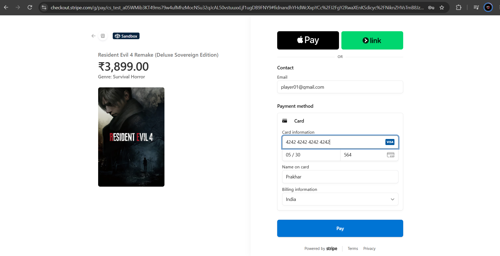
  <p><em>Stripe Checkout Gateway: Secure sandbox payment session displaying edition pricing, customer authentication, and payment method capture.</em></p>
</div>

---

### 3. Sub-Millisecond In-Memory BM25 & Prefix Trie Search

Executing `ILIKE %query%` SQL queries on every user keystroke causes full table scans, disk IOPS saturation, and database pool starvation under concurrent traffic.

To eliminate database dependency during discovery, GameStation isolates game search into a **custom in-memory prefix indexing engine**:

- **Prefix Trie Structure**: Built in Node.js memory at server boot. All published titles, developer studio names, and tags are mapped character-by-character into a prefix tree.
- **Levenshtein Distance Spell-Checking**: Constant-time fuzzy string matching that detects typographical errors and suggests corrections (e.g., query `"Rdrd"` returns `"Did you mean: 'red'"`).
- **Okapi BM25 Ranking**: Multi-token ranking calculating Term Frequency (TF) and Inverse Document Frequency (IDF) saturation to score game relevance.
- **Performance**: Search requests resolve in **`~1.68 ms`**, returning highlighted token matches and relevance scores with zero database queries.

<div align="center">
  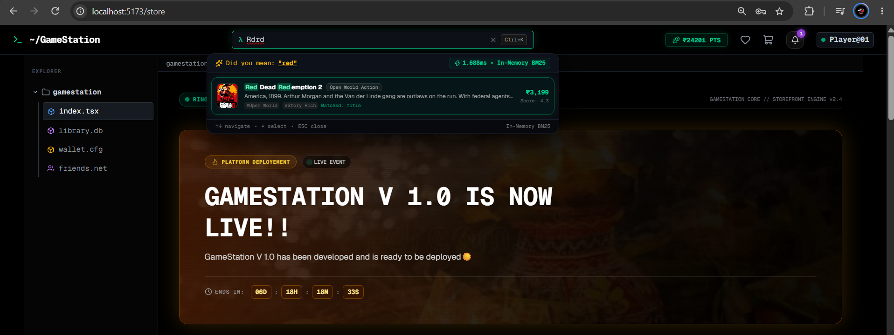
  <p><em>Instant Search Engine: Resolving in 1.688ms with in-memory BM25 scoring, highlighted match tokens, and Levenshtein spelling correction.</em></p>
</div>

---

### 4. Native W3C Distributed Tracing (APM) & FlameGraphs

Rather than adding heavy external third-party agent daemons, GameStation features an in-house **Application Performance Monitoring (APM)** engine:

- **AsyncLocalStorage Context Propagation**: Captures request lifecycles across asynchronous boundaries, assigning each request a standard W3C `traceparent` identifier.
- **Hierarchical Sub-Span Profiling**: Measures individual execution phases within each request:
  - Express middleware resolution
  - Prisma database operations (e.g. `User.findFirst`, `Session.deleteMany`, `Session.create`)
  - Payload serialization latency
- **Visual FlameGraphs & Latency Waterfall**: Generates interactive span breakdowns showing exact duration, execution percentage, HTTP metadata, and database execution times, alongside P50, P95, and P99 latency tracking.

<div align="center">
  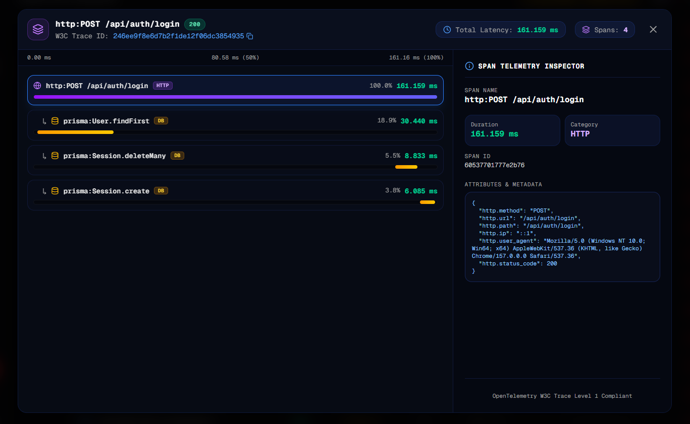
  <p><em>W3C Trace Inspector: Sub-span FlameGraph breakdown profiling a POST /api/auth/login request down to individual Prisma database query durations.</em></p>
</div>

<div align="center">
  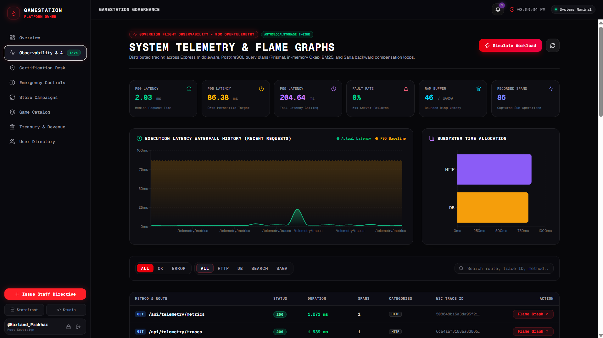
  <p><em>System Telemetry Radar: Real-time latency waterfall tracking P50, P95, and P99 baselines with subsystem time allocation metrics.</em></p>
</div>

---

### 5. RFC 6585 Sliding Window Log Rate Limiter & Abuse Tracking

To protect authentication endpoints and sensitive financial routes from brute-force attacks and credential stuffing, GameStation implements an in-memory **Sliding Window Log Rate Limiter**:

- **Mathematical Precision**: Unlike fixed-window counters that permit 2x traffic bursts across boundary resets, the sliding window log stores exact request timestamps, eliminating burst vulnerabilities entirely.
- **Client Key Resolution**: Dynamically prioritizes verified `user:${userId}` for authenticated users, falling back to proxy-aware `ip:${clientIp}` extracting through `X-Forwarded-For`.
- **RFC 6585 Compliance**: Injects standard HTTP throttling headers on all outgoing responses:
  - `X-RateLimit-Limit`: Maximum permitted request quota.
  - `X-RateLimit-Remaining`: Remaining request tokens in the active sliding window.
  - `X-RateLimit-Reset`: Unix epoch timestamp when the current window resets.
  - `Retry-After`: Seconds to wait before subsequent attempts when throttled with `429 Too Many Requests`.
- **APM Integration**: Throttled requests are automatically tagged inside the active OpenTelemetry span (`rateLimited=true`, `tier=AUTH_STRICT`), making abusive spikes instantly visible in telemetry radars.
- **Automatic Memory Cleanup**: An unreferenced background garbage collector runs every 60 seconds to prune expired timestamps, ensuring bounded memory usage.

---

### 6. Real-Time WebSocket Architecture & Squad Social Graph

GameStation incorporates an event-driven **Socket.IO** cluster to power instant peer-to-peer communications and live platform observability without polling overhead:

- **Isolated Channel Rooms**: Direct transmissions and squad messages are routed through cryptographically isolated, authenticated room namespaces (`room:user_a_user_b`), preventing message cross-talk between players.
- **Heartbeat Presence Matrix**: Bidirectional ping-pong polling tracks live player statuses in real time across three states: `Online`, `In-Game (Active Game Title)`, and `Offline Matrix`.
- **Ephemeral Typing & Instant Delivery**: Low-latency typing indicators and message dispatch with sub-10ms delivery and instant persistence to PostgreSQL.
- **Live Platform Event Stream**: Dispatches real-time broadcast events (new verified purchases, player reviews, and developer releases) across connected operator flight decks and owner cockpits.

<div align="center">
  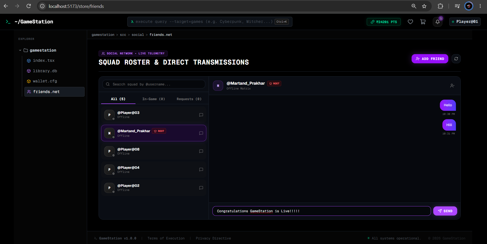
  <p><em>Squad Roster & Transmissions: Real-time WebSocket messaging, friend list management, and presence indicators.</em></p>
</div>

---

### 7. Platform Economics, Governance & Developer Studio

- **Sovereign Treasury & Financial Ledger**: Features a dynamic platform take-rate slider (default 30%) with automated gross inflow calculation and itemized cryptographic settlement records.
- **5-Axis Technical Quality Benchmark Radar**: Developers receive multi-dimensional feedback from verified game owners across **Optimization**, **Fun Factor**, **Sound Design**, **Visuals & Art**, and **Stability & Netcode**.
- **Operations Flight Deck**: Provides platform administrators with live submission queues, 24-hour review velocity metrics, and SLA certification trends.

<div align="center">
  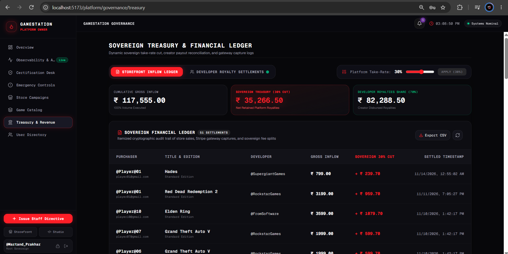
  <p><em>Sovereign Treasury & Financial Ledger: Dynamic take-rate settlement ledger tracking gross inflow and creator payouts.</em></p>
</div>

<div align="center">
  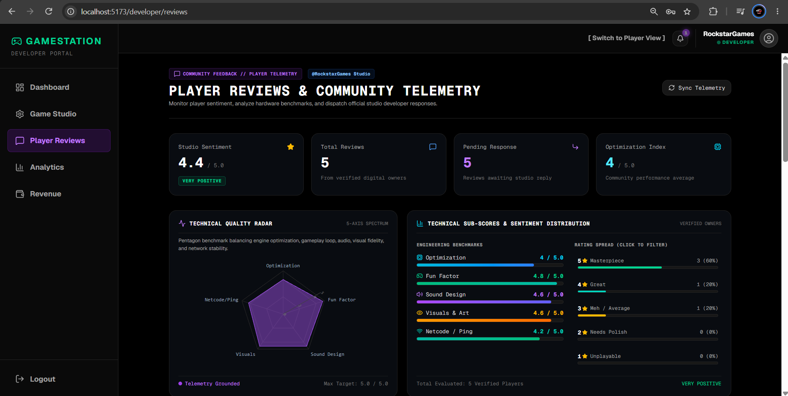
  <p><em>Developer Studio: 5-axis technical quality radar and sentiment distribution based on verified-owner telemetry.</em></p>
</div>

---

### 8. Client Performance & Route-Level Code Splitting (93% Bundle Reduction)

To guarantee sub-second Time to Interactive (TTI), GameStation re-engineered its client application bundle:

- **Route-Level Dynamic Imports**: Separated Storefront, Developer Studio, Admin Flight Deck, and Governance Cockpit into independent `React.lazy()` chunks.
- **Vendor Chunk Isolation**: Configured Vite Rollup bundling to isolate heavy dependencies (`vendor-recharts` at 431 kB and `vendor-react`) into standalone long-term cached bundles.
- **Zero-CLS Suspense Boundaries**: Two-tier `<Suspense>` boundaries integrated with custom `CyberSkeleton` loaders to eliminate Cumulative Layout Shift (CLS) during asynchronous route transitions.
- **Bundle Metrics**:
  - Initial JavaScript bundle reduced from **1,881.94 kB** down to **130.77 kB** (**39.25 kB gzipped**).
  - Achieved a **93.0% reduction** in initial script evaluation time.

<div align="center">
  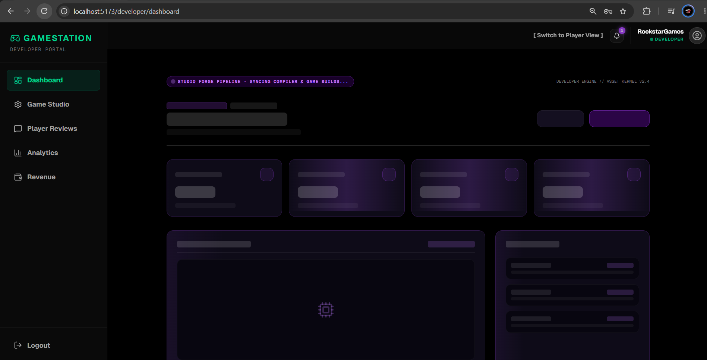
  <p><em>Cyberpunk Skeleton Loaders: Zero-CLS suspense fallback during route-level dynamic chunk resolution.</em></p>
</div>

---

### 9. Production Multi-Stage Docker Architecture

GameStation is fully containerized with a production multi-stage orchestration strategy:

- **Backend Container**: Multi-stage `node:22-slim` image compiling TypeScript down to clean ECMAScript modules with production-only dependencies (~177 MB).
- **Frontend Container**: Multi-stage `nginx:alpine` image compiling React 19 static assets and serving them through a reverse proxy with gzip compression and SPA route fallbacks (~26.9 MB).
- **Graceful Shutdown**: The Node server handles `SIGINT` and `SIGTERM` signals by draining active HTTP connections and disconnecting Prisma connection pools within <300ms.
- **Efficiency**: The complete production stack (PostgreSQL 18 + Backend + Nginx Frontend) runs inside **~131.7 MiB of host RAM**.

---

<a id="tech-stack"></a>
## 💻 Tech Stack Matrix

| Domain | Technology | Version | Purpose |
| :--- | :--- | :--- | :--- |
| **Frontend Framework** | React | `19.0.0` | Declarative UI rendering & state management |
| **Build Tool** | Vite | `6.0.0` | Hot Module Replacement (HMR) & Rollup bundling |
| **Language** | TypeScript | `5.7.0` | End-to-end type safety |
| **Styling** | Tailwind CSS | `4.0.0` | Custom cyberpunk design system & utility classes |
| **Routing** | React Router | `7.0.0` | Declarative client-side routing & dynamic code splitting |
| **Data Visualization**| Recharts | `2.15.0` | 5-axis quality radars & telemetry latency charts |
| **Backend API** | Express.js | `5.0.0` | REST API routing & middleware pipeline |
| **Database** | PostgreSQL | `18.0` | ACID-compliant relational data persistence |
| **ORM** | Prisma | `6.0.0` | Type-safe database queries & migration schema |
| **Real-Time** | Socket.IO | `4.8.0` | WebSockets for squad chat & telemetry stream |
| **Payments** | Stripe SDK | `17.0.0` | Checkout sessions, webhooks & payout flows |
| **Containerization** | Docker & Compose | Multi-Stage | Unified service orchestration & Nginx edge proxy |
| **Validation** | Zod | `3.23.0` | Runtime request body schema validation |

---

<a id="quickstart"></a>
## 🚀 Quickstart & Development Saga

GameStation supports two distinct developer workflows: **Lightweight Hybrid Development** (instant HMR for coding) and **Full Containerized Verification** (pre-push smoke testing).

### Prerequisites
- [Node.js (v20+)](https://nodejs.org/)
- [Docker Desktop](https://www.docker.com/)

---

### Workflow A: Hybrid Development (Recommended for Daily Coding)
*Keep PostgreSQL in Docker while running Frontend and Backend natively on your host for instant `<20ms` hot-reloading.*

1. **Clone the repository**:
   ```bash
   git clone https://github.com/martand-codes/GameStation.git
   cd GameStation
   ```

2. **Start PostgreSQL in Docker**:
   ```bash
   docker compose up -d postgres
   ```

3. **Setup and run the Backend**:
   ```bash
   cd Backend
   npm install
   npx prisma generate
   npx prisma db push
   npm run dev
   ```

4. **Setup and run the Frontend**:
   ```bash
   cd ../Frontend
   npm install
   npm run dev
   ```
   Open `http://localhost:5173` in your browser.

---

### Workflow B: Full Production Docker Stack
*Spin up the entire production stack (PostgreSQL + Backend + Nginx Frontend) with a single command.*

```bash
# Start all services with automated multi-stage builds
docker compose up --build -d
```
- **Frontend & Nginx Edge**: `http://localhost:3000`
- **Backend API**: `http://localhost:5001/api`
- **PostgreSQL**: `localhost:5433`

To tear down the stack gracefully:
```bash
docker compose down
```

---

<a id="benchmarks"></a>
## 📊 Performance Benchmarks

| Metric | Target / Measurement | Engineering Implementation |
| :--- | :--- | :--- |
| **Search Query Latency** | **`< 2.0 ms`** (P95) | In-Memory Prefix Trie & Okapi BM25 Index |
| **Database Pool Query Time** | **`< 10 ms`** (P50) | PostgreSQL 18 connection tuning via Prisma |
| **Initial JS Bundle Size** | **`130.77 kB`** (39 kB gzip) | Route-level `React.lazy()` & Vendor chunking |
| **Client Bundle Reduction** | **`93.0%` Reduction** | Eliminated monolithic bundle (down from 1.88 MB) |
| **Docker Stack RAM Footprint** | **`~131.7 MiB`** Total | Multi-stage Alpine & Debian-slim containerization |
| **Saga Compensation Time** | **`< 150 ms`** | Automated backward rollback on transaction failure |
| **Rate Limiter Overhead** | **`< 0.05 ms`** | In-memory sliding window timestamp log |

---

## 👨‍💻 Author & Engineering Credits

Built by **Martand Prakhar**  
- 🌐 **Portfolio**: [martandprakhar-portfolio.vercel.app](https://martandprakhar-portfolio.vercel.app/)  
- 💼 **LinkedIn**: [Martand Prakhar](https://www.linkedin.com/in/martand-prakhar-a04904315/)  
- 🐙 **GitHub**: [@martand-codes](https://github.com/martand-codes)

---

## 📝 License
This project is open-source and licensed under the [MIT License](LICENSE).
